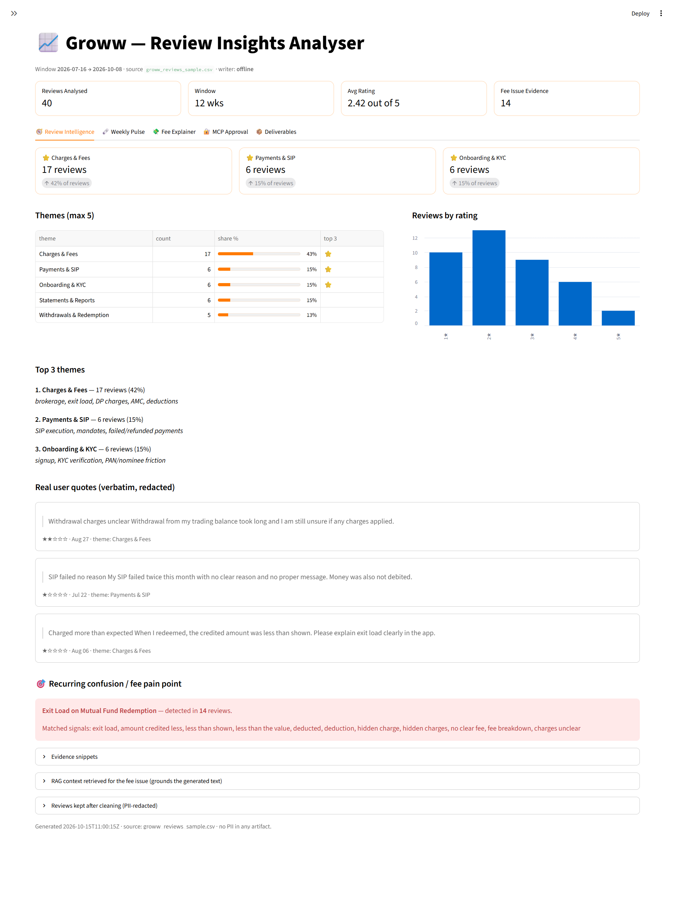
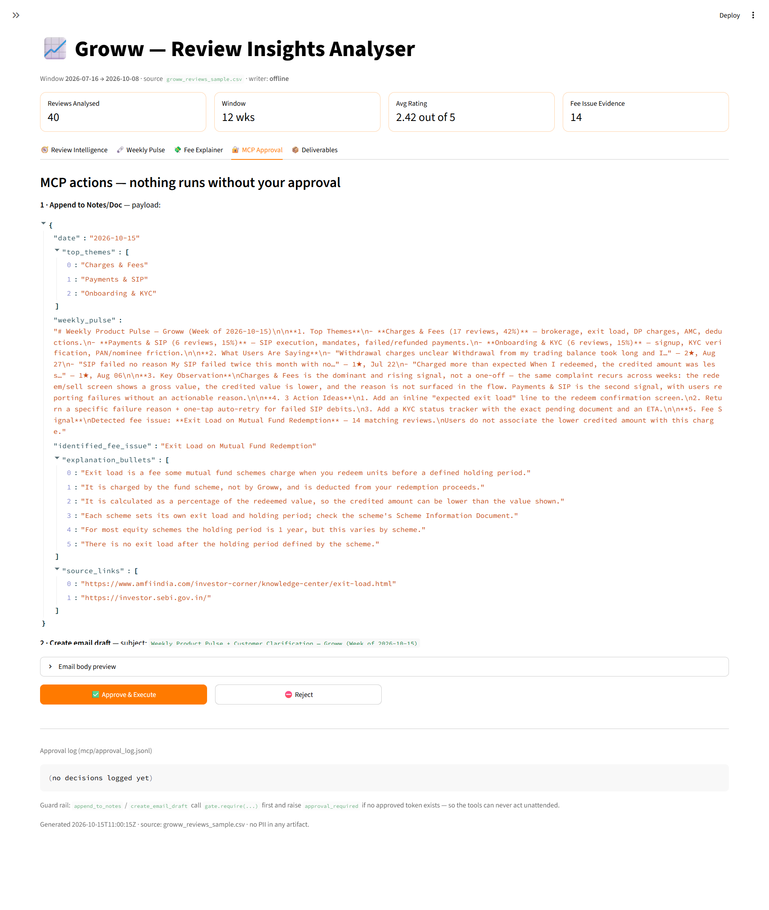

# Demo Script — Groww Review Insights Analyser (≤ 3 min)

A spoken walkthrough of the Streamlit prototype. Total run time ≈ **2:45**.

**Pre-flight (before you hit record)**
- Terminal A (repo root): `streamlit run app.py` → browser opens on `http://localhost:8501`.
  *(Or demo the hosted build: <https://groww-review-insights.streamlit.app/> — click **Wake up** first if it's asleep.)*
- Terminal B (repo root), for the 2:30 re-run beat.
- Sidebar shows **Gemini key detected — live text.** if a key is set, otherwise the deterministic
  offline-writer note — both are valid; the constraints are met either way.
- Optional: open `outputs/notes_doc.md` and `outputs/email_draft.eml` in a side window so you can
  reveal them instantly at **2:00**.
- Leave **Upload a public reviews CSV** empty — the app uses the built-in
  `data/groww_reviews_sample.csv` (40 reviews).

---

## The beats

| Time | On screen — exact clicks | Say |
|---|---|---|
| **0:00** | **Landing screen.** Heading *"📈 Groww — Review Insights Analyser"* + the four cards (*1 · Review intelligence · 2 · Weekly pulse · 3 · Fee explainer · 4 · MCP gate*). **Click nothing yet.** | "Groww users are confused about fees they only notice *after* they redeem. In three minutes I'll turn the last 12 weeks of public reviews into a weekly pulse and a plain-language fee explainer — then push them through an approval-gated MCP." |
| **0:20** | Sidebar → **1 · Reviews source**: leave **Upload a public reviews CSV** empty; set the **Look-back window (weeks)** slider to **12**; click **▶ Run analysis**. Watch the progress lines in the panel. | "Reviews come from a public export — no logins, no scraping. We keep the 12-week window and every review is **PII-redacted before anything else runs**." |
| **0:25** | In the progress panel point at the *"N kept · N PII redactions"* line. Then open **🧭 Review Intelligence → Reviews kept after cleaning (PII-redacted)** and point at `[REDACTED]`. | "Emails, phone numbers, UPI IDs and order IDs are replaced with `[REDACTED]` up front, so no PII can reach the model, the doc, or the email." |
| **0:40** | **🧭 Review Intelligence** tab. Point at the three metric cards and **Top 3 themes**. Then scroll to **Real user quotes (verbatim, redacted)**. | "Clustering keeps ≤ 5 themes; the top 3 are **Charges & Fees**, **Payments & SIP** and **Onboarding & KYC**. These three quotes are **verbatim from the CSV** — the model can't invent them — and they're already redacted." |
| **1:00** | **🗞️ Weekly Pulse** tab. Point at *"Word count: 223 / 250"* and the progress bar. | "The one-page internal note is hard-capped at 250 words — it's **223**. Three themes, three quotes, one key observation, and exactly **three action ideas**." |
| **1:20** | **💸 Fee Explainer** tab. Point at *"6 bullets (max 6)"*, then the **Sources** list and **Last checked: 2026-10-15**. | "A customer-facing explainer: **≤ 6 facts-only bullets**, exactly **2 official source links** — AMFI and SEBI — and a **Last checked** date. Facts only, no marketing." |
| **1:40** | **🔐 MCP Approval** tab. Point at the JSON payload, then at **✅ Approve & Execute** and **⛔ Reject**. **Do not click yet.** | "And here's the important part — **nothing has been written or emailed**. This is the exact payload MCP would write. Both tools are gated: call them without an approved token and they raise `approval_required`." |
| **2:00** | Click **✅ Approve & Execute** — *the click is the approval token*. Reveal `outputs/notes_doc.md` (the appended doc entry) and `outputs/email_draft.eml` (the Gmail-style draft — open it in Gmail/Outlook to preview). Point at the **Approval log** block at the bottom of the tab. | "Only now do the two tools run: `append_to_notes` writes the entry, and `create_email_draft` builds an email **draft — never sent**. Every decision lands in `mcp/approval_log.jsonl`." |
| **2:30** | Terminal B: `python -m src.run_all --weeks 12 --input data/your_new_export.csv`. Then back in the app: click **▶ Run analysis** → **🔐 MCP Approval** → **✅ Approve & Execute**. | "For a new week you drop the new public export in `data/` and run **one command**. New doc entry, new draft, new approval-log lines — the old ones are preserved." |
| **2:45** | Back on **📦 Deliverables** tab (optional 5-second outro). | "Every constraint is checked automatically: ≤ 5 themes, ≤ 250 words, 3 quotes, ≤ 6 bullets, 2 sources, and a human approval step. That's the loop." |

> The built-in sample run shown here reports **40 reviews · 14 fee matches · 223-word pulse**. The
> repo-canonical `python -m src.run_all --weeks 12` over the full public export gives **43 reviews
> · 17 fee matches** (same constraints) — see the README.

---

## Key screenshots

**Review Intelligence** (0:40–1:00) — top-3 themes, 3 verbatim redacted quotes, and the recurring
fee pain point with the retrieved RAG context:

**MCP Approval** (1:40–2:00) — the exact payload is shown and *nothing* runs until you click
**Approve & Execute** (the click is the human approval token):

Other beats: [`img/03-weekly-pulse.png`](img/03-weekly-pulse.png) (1:00),
[`img/04-fee-explainer.png`](img/04-fee-explainer.png) (1:20),
[`img/06-deliverables.png`](img/06-deliverables.png) (2:45). Full set in [`img/README.md`](img/README.md).

### Capturing the 2:00 "after approval" beat (doc entry + Gmail draft)

After clicking **Approve & Execute**, two artifacts exist — capture them for the video:

1. `outputs/notes_doc.md` — the appended doc entry (date, themes, pulse, fee issue, bullets, links).
2. `outputs/email_draft.eml` — the Gmail-style draft. To show it *as a Gmail draft*, open Gmail →
   **Compose** → (⋮) **Import / open** `email_draft.eml`, or open the `.md` twin in any viewer, and
   screenshot the draft window with the subject
   *"Weekly Product Pulse + Customer Clarification — Groww (Week of <date>)"* visible.

---

## Tips
- The pipeline **always works offline** — if there's no `GEMINI_API_KEY` (or Gemini rate-limits),
  `src/llm.py` falls back to the deterministic writer and every constraint still holds. Say so if
  asked; it's a feature, not a failure.
- If asked *"is this real MCP?"* → the app uses `src/mcp_tools.py` (the two gated tools +
  `ApprovalGate`); `mcp/server.py` exposes the **same** tools over the real MCP stdio protocol
  (`pip install mcp`), and `mcp/approval.py` is the terminal gate (type `APPROVE`).
- Prove the guard rail live: `python -m src.mcp_tools` prints `BLOCKED as expected`.
